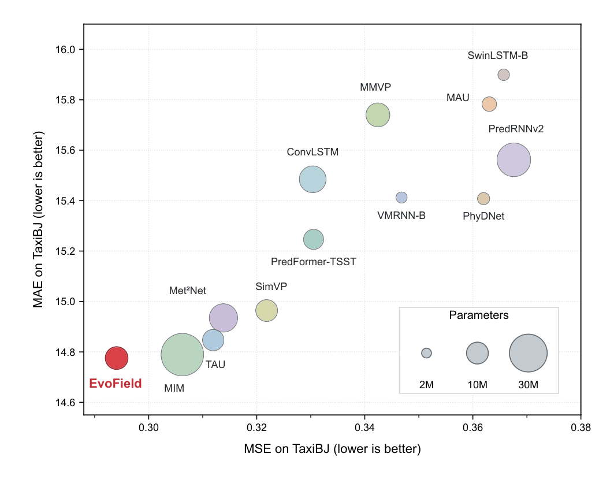

# EvoField

EvoField is a spatiotemporal prediction model that couples directional propagation and local correction. Both paths use shared dynamic conditioning to update latent features.



## Installation

Use a Linux CUDA environment with Conda:

```bash
conda env create -f environment.yml
conda activate OpenSTL
python -m pip install -e .
```

The dependency files are included for setup. GPU execution of this export has not been verified.

## Data preparation

See `tools/prepare_data/` and the task-specific loaders in `openstl/datasets/` for dataset acquisition and layout. Set `--data_root` to the directory containing the prepared datasets.

The Moving MNIST loader requires `OPENSTL_MMNIST_VAL_PATH` to point to a frozen validation array. Use a uint8 NumPy array arranged as sample, time, channel, height and width. In the recorded run this file was the official test sequences transposed into that layout for use during validation. Obtain the source sequences under their original terms.

## Core implementation

- `openstl/modules/mlo_tau_v3_tsr_modules.py`: directional propagation and signed correction.
- `openstl/models/simvp_model.py`: encoder, evolution blocks and decoder integration.
- `openstl/methods/tau.py`: training objective and method wrapper.
- `configs/`: task configurations.
- `tools/train.py` and `tools/test.py`: training and evaluation entry points.

## Usage

The following commands use the configurations in this export. The Human example uses the archived 128×128 configuration with an accumulation setting of 8. The paper's Human run used 256×256 and effective accumulation 1. The archived configuration is included as a reference. For KTH, the generic test entry uses floating-point PSNR, whereas the paper's KTH PSNR uses framewise unsigned 8-bit arithmetic. The dedicated paper evaluation script is not included in this package.

```bash
export OPENSTL_TAXIBJ_PROTOCOL=official
export OPENSTL_KTH_PROTOCOL=pfg_official
python tools/train.py -d taxibj --method tau --config_file configs/taxibj/MLO_TAU_V3_TSR.py --data_root ./data --res_dir ./work_dirs --ex_name evofield_taxibj --epoch 50 --skip_test
python tools/test.py -d taxibj --method tau --config_file configs/taxibj/MLO_TAU_V3_TSR.py --data_root ./data --res_dir ./work_dirs --ex_name evofield_taxibj --test
python tools/train.py -d mmnist --method tau --config_file configs/mmnist/MLO_TAU_V3_TSR_E200.py --data_root ./data --res_dir ./work_dirs --ex_name evofield_mmnist --epoch 200 --skip_test
python tools/test.py -d mmnist --method tau --config_file configs/mmnist/MLO_TAU_V3_TSR_E200.py --data_root ./data --res_dir ./work_dirs --ex_name evofield_mmnist --test
python tools/train.py -d human --method tau --config_file configs/human/MLO_TAU_V3_TSR_Walking128_Unified.py --data_root ./data --res_dir ./work_dirs --ex_name evofield_human --epoch 100 --skip_test
python tools/test.py -d human --method tau --config_file configs/human/MLO_TAU_V3_TSR_Walking128_Unified.py --data_root ./data --res_dir ./work_dirs --ex_name evofield_human --test
python tools/train.py -d kth20 --method tau --config_file configs/kth/MLO_TAU_V3_TSR_10to20.py --data_root ./data --res_dir ./work_dirs --ex_name evofield_kth20 --epoch 100 --skip_test
python tools/test.py -d kth20 --method tau --config_file configs/kth/MLO_TAU_V3_TSR_10to20.py --data_root ./data --res_dir ./work_dirs --ex_name evofield_kth20 --test
python tools/train.py -d kth40 --method tau --config_file configs/kth/MLO_TAU_V3_TSR_10to40.py --data_root ./data --res_dir ./work_dirs --ex_name evofield_kth40 --epoch 100 --skip_test
python tools/test.py -d kth40 --method tau --config_file configs/kth/MLO_TAU_V3_TSR_10to40.py --data_root ./data --res_dir ./work_dirs --ex_name evofield_kth40 --test
```

### Navier-Stokes T20

Supply a prepared MAT file with a float32 variable `u` shaped
`(1200, 64, 64, 20)`. The adapter uses contiguous splits of 864, 96 and
240 sequences and predicts the last 10 frames from the first 10. This
release entry uses the archived EvoField architecture, the shared T20
data adapter and gradient accumulation 1. This entry point reports metrics in raw data units. The paper tables use a fixed training-pool min–max transformation, so the reported metrics from this entry point are not the paper-table metrics.
Run from the installed repository environment. Output directories must be new.

```bash
python tools/run_evofield_t20.py --data data/navier_stokes_t20/NavierStockT20.mat --output work_dirs/evofield_t20
python tools/run_evofield_t20.py --data data/navier_stokes_t20/NavierStockT20.mat --output work_dirs/evofield_t20_test --checkpoint work_dirs/evofield_t20/checkpoints/best.ckpt
```


## Source and license

This project builds on [OpenSTL](https://github.com/chengtan9907/OpenSTL). The exported project working tree records source checkout HEAD `3fb54107af8d8c5a1a30780b9c65624b7b135594`. See `LICENSE` for licensing terms.
